# TAX-SHIELD

**Evidence-aware Indian income-tax research prototype** built with FastAPI, SQLite, and React. TAX-SHIELD explores how an answer system can preserve source traceability, tax-period context, and safe abstention rather than presenting an unsupported model response as law.

> **Responsible use:** This prototype is not legal or tax advice and does not guarantee legal correctness. Verify the governing Act, rules, notifications, circulars, amendments, and facts with an appropriately qualified professional. A government URL alone does not establish that a passage is current or legally applicable.

## Problem and motivation

Ordinary LLM-only responses can conflate assessment years, omit conditions, and invent citations. TAX-SHIELD separates source retrieval and applicability checks from answer formatting. Its current answer generator is deterministic (not an LLM): it produces a bounded response from selected passages or abstains. This is a research prototype, not a production tax database.

## Current feature status

| Component | Implemented status |
| --- | --- |
| React + TypeScript research interface | Implemented; talks to the FastAPI API |
| FastAPI chat, health, sources, and admin ingestion routes | Implemented |
| Official-domain URL allowlist, HTTPS requirement, bounded allowlisted redirects, DNS public-address check, bounded download | Implemented; DNS check has the normal resolver-to-connect race limitation |
| HTML/PDF extraction, normalized content hashing, versioned document IDs, SQLite document/chunk persistence | Implemented; extraction quality needs validation on actual source documents |
| BM25 | Implemented; rebuilt in process from persisted chunks at startup |
| Vector retrieval | **Placeholder only:** deterministic hash vectors, not semantic embeddings |
| ChromaDB | **Not implemented** |
| RRF | Implemented; combines BM25 and placeholder-vector ranks |
| Optional reranking | Lexical substring heuristic only; no learned reranker |
| Tax-period resolver and applicability validator | Implemented conservatively; source periods are not inferred during ingestion |
| Citation integrity | Citations are constructed from selected evidence and checked against record IDs, URL, and passage |
| LLM answer generation / provider integration | **Not implemented.** The configured answer path is deterministic; no provider API key is used |
| Authentication / tenant isolation | **Not implemented.** Admin ingestion requires a configured shared key; conversation enumeration/history endpoints are disabled. Chat is not suitable for private multi-user data |
| Automated ingestion schedule | **Not implemented.** Sync is an explicit admin endpoint |
| Live official-source ingestion and legal-quality benchmark | **Not verified.** No live counts or legal accuracy metrics are claimed |

The default source registry contains official portal home pages, not an enumerated, curated collection of legislation. A portal fetch must not be interpreted as a complete statute corpus. Unknown tax-period metadata causes requested-period evidence to be unresolved and the answer path to abstain.

## Architecture

```mermaid
flowchart LR
    O[Allowlisted official URLs] --> F[Guarded fetch: HTTPS, public DNS check, bounded same-allowlist redirects, size cap]
    F --> X[HTML/PDF extraction and cleaning]
    X --> V[Content hash, document version, SQLite + files]
    V --> C[Legal text chunks]
    C --> B[BM25 index]
    C --> H[Hash-vector placeholder]
    B --> R[RRF ranking]
    H --> R
    R --> T[Tax-period and applicability validation]
    T --> E[Evidence selection]
    E -->|validated record| Q[Citation manager]
    E -->|missing/conflicting evidence| A[Clarify or abstain]
    Q --> G[Deterministic bounded answer]
    G --> API[FastAPI]
    API --> UI[React / Vite client]
```



### Retrieval and legal-period handling

BM25 and the current vector placeholder each return ranked chunk IDs. Reciprocal rank fusion combines those ranks, followed by metadata filtering and evidence applicability checks. Historical periods are not silently changed to a current period. The ingestion pipeline does not currently infer statutory effective dates or assessment years; when the requested period cannot be verified from chunk metadata, TAX-SHIELD abstains rather than filling in that information.

Citations are generated from selected evidence objects, not free-form model text. Validation checks the chunk and document identifiers, allowlisted HTTPS source URL, and supporting passage against the retrieved record. This verifies provenance linkage, not legal correctness.

### Ingestion workflow

The admin sync route fetches enabled registry entries, extracts and chunks usable content, stores raw and processed files plus document/chunk metadata in SQLite, and retains content-addressed historical document versions. Identical fetched text is treated as unchanged. A failed source is reported independently and does not overwrite the last successful content hash. Successful chunks are loaded into in-memory retrieval indexes at startup and after sync; BM25 and vector indexes are rebuilt from the persistent SQLite corpus.

### Live-source check (2026-10-20)

A real sync was run against both configured portal roots. The `incometax.gov.in` portal returned usable HTML and produced **1 persisted chunk** (title: “Home | Income Tax Department”); the `incometaxindia.gov.in` portal returned HTTP 403. These counts are portal-page ingestion counts, not statutory-document coverage. A real chat request for section 80C/AY 2025-26 returned HTTP 200 with `insufficient_evidence` and zero citations because the ingested portal chunk had no verified tax-period applicability metadata. The result is a safe abstention, not an answer-quality success. The second source's unavailability is not evidence that its legal content was withdrawn.

The retrieval experiment was run before the successful portal fetch: at that point there were 0 benchmark cases, 0 labelled cases, and 0 persisted chunks, so Recall@5, MRR, latency, and evidence coverage were all `null`. After the portal fetch, there is still no manually reviewed benchmark or relevant-chunk annotation; rerun the evaluator against the current corpus to report corpus count, but no quality metrics can be calculated until reviewed labels exist.

Six representative API cases were also exercised against the current persisted corpus: deduction lookup, regime comparison, historical-period question, amendment-sensitive question, ambiguous period, and contradictory selected/question period. The first four returned `insufficient_evidence` with zero citations; the ambiguous and contradictory cases returned `needs_clarification`, also with zero citations. These are control-flow checks only, not evidence of legal answer quality.

After that earlier check, an official Income Tax Department “Common ITR Filing FAQs AY 2024-25” PDF was discovered, fetched from the official domain, extracted, and persisted as 9 chunks. A real-corpus request about Section 80C under the new regime for AY 2024-25 retrieved 6 applicable chunks; all 6 citations validated against their source passage and URL. The response was limited to the FAQ's statement about the new-regime restriction and exceptions, and explicitly did not state a Section 80C deduction amount. This is a source-grounded integration check, not independent legal review or a guarantee of completeness.

## Stack

- Backend: Python 3.11+, FastAPI, Pydantic, SQLite
- Ingestion: Requests, BeautifulSoup, PyMuPDF
- Retrieval: rank-bm25, deterministic vector placeholder, reciprocal rank fusion
- Frontend: React 18, TypeScript, Vite, Tailwind CSS, Lucide
- Tests: pytest; frontend production build/type check via Vite script
- Deployment templates: Dockerfiles, Docker Compose, GitHub Actions CI

## Local setup

### Backend

From the repository root, copy `.env.example` to `.env` and set a unique `ADMIN_API_KEY` (at least 32 characters for production mode). Install and start:

```bash
cd backend
python -m venv .venv
# Windows PowerShell: .venv\Scripts\Activate.ps1
# macOS/Linux: source .venv/bin/activate
python -m pip install -r requirements.txt
python -m uvicorn app.main:app --reload --host 127.0.0.1 --port 8000
```

Health check: `http://127.0.0.1:8000/health`.

### Frontend

```bash
cd frontend
npm ci
npm run dev
```

Set `VITE_API_BASE_URL` at build time if the backend is not at `http://127.0.0.1:8000`. Never put backend secrets in `VITE_*` variables: Vite embeds them into public client assets.

### Environment variables

| Variable | Purpose |
| --- | --- |
| `ENVIRONMENT` | `development` or `production`; production requires a 32+ character admin key |
| `ADMIN_API_KEY` | Shared secret for admin ingestion endpoints; keep backend-only |
| `CORS_ORIGINS` | Comma-separated explicit browser origins; wildcard is rejected |
| `DATA_DIR` | Directory for raw/processed/metadata files and default SQLite data location |
| `DB_PATH` | SQLite file path; set separately when needed |
| `MAX_REQUEST_BYTES` | Maximum declared request body size; chat question also has a character limit |
| `RATE_LIMIT_PER_MINUTE` | Per-process, per-client-IP API request limit |
| `LOG_LEVEL` | Present for deployment configuration; application logging policy is minimal |

There is no LLM provider configuration because no provider integration is implemented. No secret is needed for chat.

## Ingestion

Ingestion is not scheduled automatically. Configure an admin key, then call `POST /api/v1/admin/ingestion/sync` with the `x-admin-key` header from a trusted administrative environment. Do not expose the key in browser code. The route refuses overlapping syncs and returns per-source statuses, counts, and failures. It is not a crawler and accepts no arbitrary user-supplied URL.

The registry includes two portal roots and an official Income Tax Department FAQ PDF explicitly labeled for AY 2024-25. The PDF is extracted and indexed as nine persisted chunks in the current local data store. Its stated period comes from the source URL; the system does not infer the legal period from fetch date. Portal pages remain too broad to serve as a complete statute corpus.

## Tests and evaluation

Backend tests:

```bash
cd backend
python -m pytest -q
```

Frontend checks/build:

```bash
cd frontend
npm ci
npm run build
```

The tests use clearly local fixtures and mock external fetches. They do not prove that an external government site is reachable or that any legal answer is correct.

A benchmark schema is in [backend/evaluation/benchmark.schema.json](backend/evaluation/benchmark.schema.json). `benchmark.jsonl` is intentionally empty: no manually reviewed official-law labels have been supplied, so no Recall@5, MRR, coverage, answer quality, or latency result is claimed. Add reviewed cases with actual `relevant_chunk_ids` before evaluating. Synthetic fixtures must be labeled separately from `real_official` evidence. Run `python evaluate_retrieval.py --benchmark evaluation/your-reviewed-cases.jsonl` from `backend/` to compare BM25, vector-only, hybrid RRF, and the lexical rerank heuristic against persisted chunks. Unannotated questions are excluded; the script reports null metrics if there are no annotated cases.

The evaluator is for retrieval only. It does not assess legal answer correctness, citation coverage, abstention accuracy, or tax-period resolution accuracy. Manual legal review is required for those outcomes.

## Security and privacy

- Secrets are read on the backend; `.env` files and local data are ignored by Git.
- Admin routes require a configured key and use constant-time comparison.
- API schemas are bounded and reject unexpected chat fields; rate limiting is in-memory and per process.
- Ingestion only accepts allowlisted HTTPS domains, rejects credentials/nonstandard ports, checks resolved addresses, permits only bounded same-allowlist redirects with a fresh address check, and enforces a streamed download cap. DNS can change between validation and connection; deploy with outbound network controls for stronger SSRF protection.
- Conversation listing and history endpoints return 404 until user authentication and authorization exist. Chat still persists question/answer messages in SQLite; IDs are not a user identity system, tenant isolation is absent, and there is no deletion/retention automation. Do not use this demo for confidential taxpayer data. Delete the persistent data volume/database to remove local records.
- Retrieved text is not passed to a tool-executing agent. There is no LLM integration in this version.

## Docker deployment

For a local container run, create a private `.env` from `.env.example`, set a random `ADMIN_API_KEY` with 32+ characters, and set `CORS_ORIGINS=http://localhost:8080` and `VITE_API_BASE_URL=http://localhost:8000`. For a public deployment, replace both with the exact HTTPS frontend origin and browser-reachable backend URL. Compose intentionally refuses to build without both values so a localhost default cannot silently ship in a production image. Then:

```bash
docker compose up --build
```

The frontend is served on port 8080 and the backend on port 8000. Compose mounts `tax-shield-data` at `/data`; this volume persists SQLite and fetched files across container restarts on the same Docker host. Back it up and protect it. The frontend API URL is baked into the Vite build. The backend uses one Uvicorn worker because its rate limit, sync lock, and search indexes are process-local; multi-replica deployment needs shared rate limiting, distributed sync locking, and index refresh coordination. ChromaDB is not used or persisted in this version.

On a hosting service, configure the same environment variables in its secret manager, set CORS to the exact HTTPS frontend origin, configure `VITE_API_BASE_URL` to the public backend API URL at build time, and attach durable storage to `/data`. Ephemeral container filesystems are not persistence. No external deployment or image publishing has been performed or authorized here. Schedule ingestion only through a trusted scheduler once source-specific behavior has been reviewed.

## CI

GitHub Actions at `.github/workflows/ci.yml` runs the backend pytest suite and frontend install/build on pushes and pull requests. It does not deploy, publish images, perform Python lint/type checks, or run a dedicated dependency/secret scanner.

## Known limitations and next steps

1. Add a reviewed, versioned official document catalog and validate real ingestion with source-specific counts.
2. Replace hash vectors with a maintained embedding model and persistent ChromaDB (or another production vector store); measure it on reviewed data.
3. Build legal-period metadata and amendment/version conflict resolution from verified legal sources.
4. Add authenticated users, conversation ownership, retention/deletion controls, and durable distributed rate limiting.
5. Add a separately evaluated LLM provider only behind prompt-injection defenses, structured output validation, and citation/evidence gates.
6. Add manually reviewed benchmark cases and answer/citation/abstention evaluation before making quality claims.

## Interview summary

TAX-SHIELD explores evidence-grounded Indian tax question answering. Instead of trusting an LLM alone, it combines lexical BM25 ranking with a vector-style candidate ranker and RRF, then checks source allowlisting and tax-period metadata before creating citations tied to retrieved passage IDs. Official pages can be ingested into content-addressed document versions and persisted chunks. Missing or conflicting applicability leads to clarification or abstention. In this repository, the vector ranker is still a deterministic hash placeholder, ChromaDB and LLM generation are not implemented, no live-source evaluation has been run, and legal accuracy is not established. The next engineering work is a reviewed source corpus, authenticated private sessions, real embeddings, and an independently labeled evaluation set.
